Fell in love with  as a kid and started taking it apart.
Years of searching myself through ,  and all kinds of 
turned me into a .
Since 2020 I'm back to code, writing Lua for 

 


<samp>
<b>2010</b>&nbsp;&nbsp;.bat / .vbs as a kid -> .ahk -> VB6 (thx, college IT teacher) -> VB.NET -> C# 
<b>2011</b>&nbsp;&nbsp;AutoIt3, Delphi 7, C++ - nah. kinda lame, didn't like em 
<b>2012</b>&nbsp;&nbsp;took games apart: hex, Cheat Engine, IDA, ring0 drivers, packets 
<b>then</b>&nbsp;&nbsp;web: html, css, js, php. no bootstrap, just "i could do it myself, but how?" 
<b>2016</b>&nbsp;&nbsp;<a href="https://vk.com/lampserv">LampServ</a> level-design volunteer -> years of mapping & optimization 
<b>2020</b>&nbsp;&nbsp;left <a href="https://vk.com/clubanigun">Team Anigun</a> (<a href="https://github.com/r3t4rd/ScriptedJobs">ScriptedJobs</a>), lil work w/ <a href="https://vk.com/an1melife">AnimeLife</a>, went solo 
<b>&nbsp;now</b>&nbsp;&nbsp;commissions · gmod gamemodes · Go infra · server tools
</samp>

<table>
<tr>
<td width="60%" valign="top">







</td>
<td width="40%" valign="top">



&nbsp;&nbsp;

</td>
</tr>
</table>

  <a href="https://r3t4rd.artstation.com/"></a>&nbsp;&nbsp;
  <a href="https://vk.com/r3t4rded"></a>&nbsp;&nbsp;
  &nbsp;
  <a href="https://yufu.su"></a>

